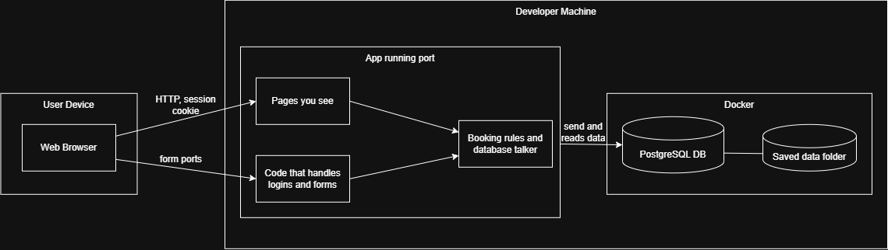
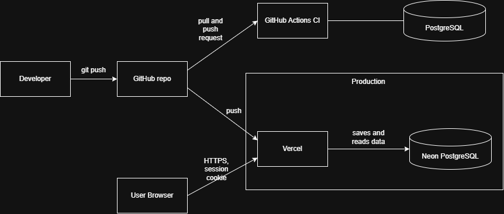

# 📐 ReservaCore Diagrams

## 🗂️ Entity relationship diagram

Three entities. The overlap rule is enforced by a PostgreSQL exclusion constraint on `Reservation`.

---

## 👥 Use case diagram

---

## 🧱 Class diagram

---

## 🔄 Sequence diagram: creating a reservation (including the conflict path)

---

## 💻 Deployment diagram: local development

---

## 🚢 Deployment diagram: production

---