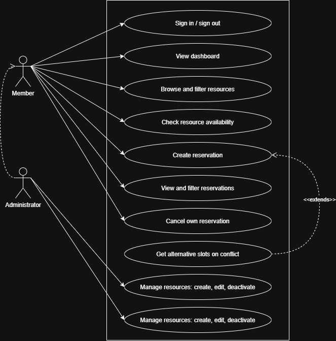
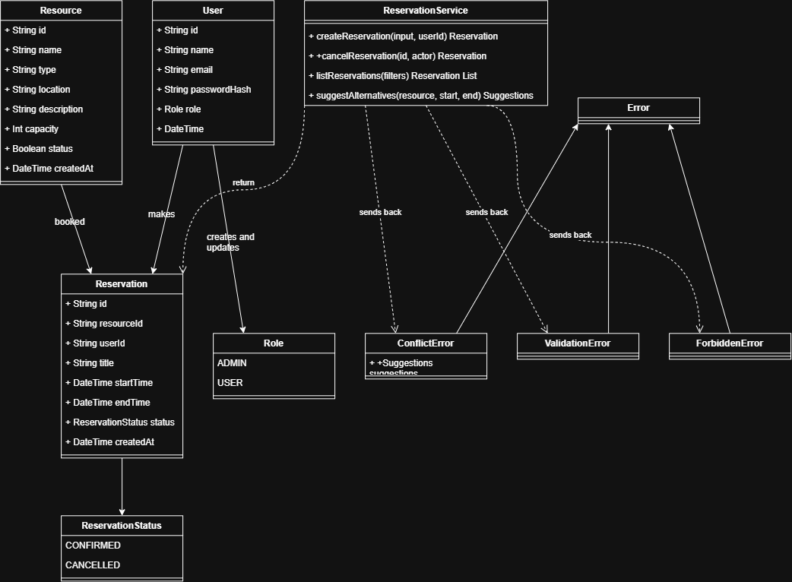
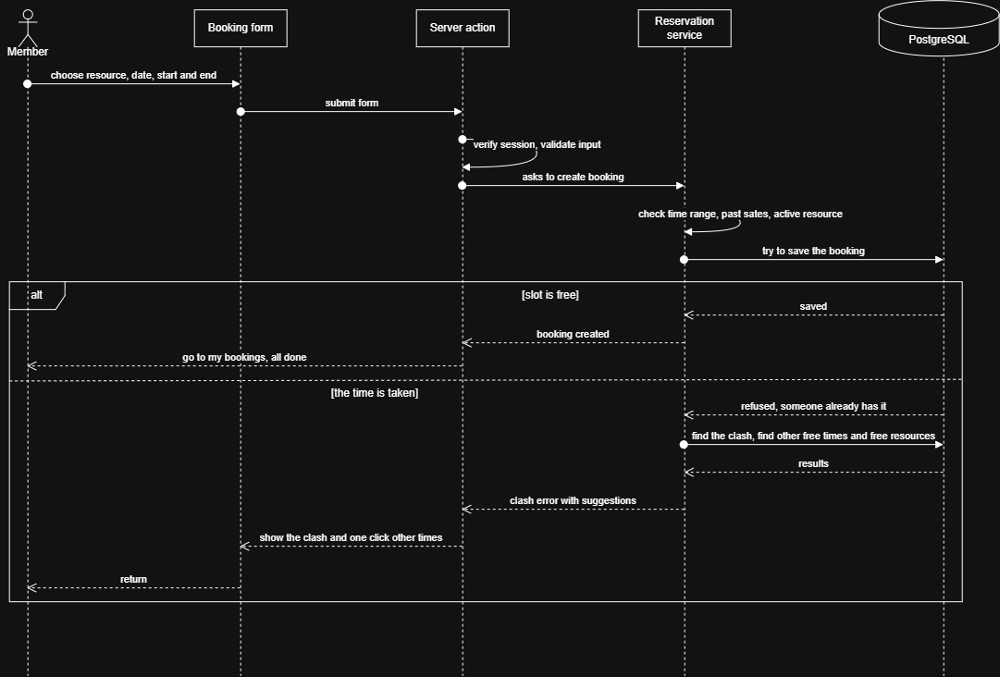

# 📐 ReservaCore Diagrams

## 1. Use case diagram

---

## 2. Class diagram (domain model and service layer)

---

## 3. Sequence diagram: creating a reservation (including the conflict path)

---

## 4. Deployment diagram (local development environment)

---